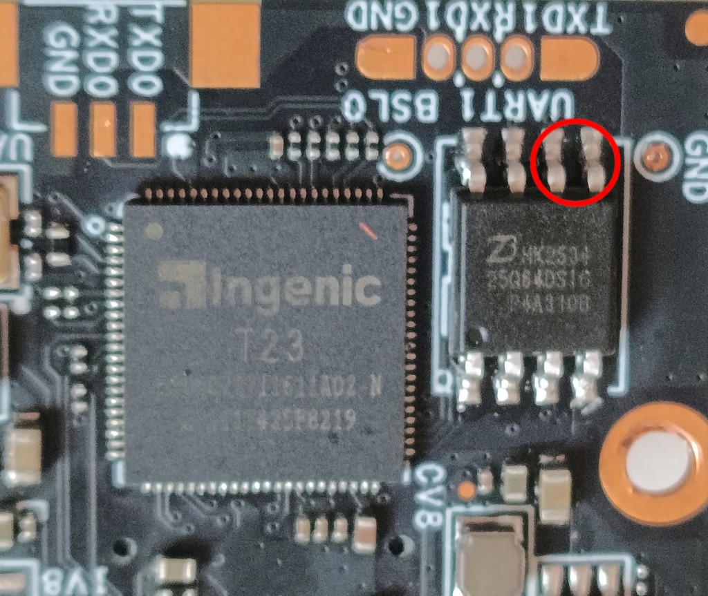

# Failed camera: USB-boot recovery without an SPI programmer

This route recovers a camera that no longer starts by forcing the Ingenic
bootrom into USB boot, reading the on-board SPI flash over USB, building the
same camera-specific recovery image that the programmer path uses, and writing
that image back over USB.

It was validated on one supported `EF-S7-V1.0.30B` / Ingenic T23 / 8 MiB unit:
three identical 8 MiB reads, a successful `cc2camera build-image`, a verified
full-chip write, and re-enumeration as a normal UVC webcam.

This path still uses **your** camera's dump. Never write another camera's
image. Prefer the [external-programmer route](../README.md#failed-camera-hardware-recovery)
if you already have a trusted CH341 setup; keep this route when you can make
the camera-to-USB cable and briefly short two flash pins.

## What you need

- the failed camera removed from the printer;
- the same [camera-to-USB pogo cable](../README.md#build-the-camera-to-usb-cable)
  used by the working-camera USB route;
- a computer that can talk to Ingenic USB boot / DFU devices
  (macOS, Linux, or Windows with the drivers described by thingino-dfu);
- [thingino-dfu](https://github.com/wltechblog/thingino-dfu) built or otherwise
  installed;
- [cc2camera installed](INSTALLATION.md) for offline `build-image` only
  (ADB is not required for this route).

## USB states to expect

| State | What you see on USB | Meaning |
|---|---|---|
| Normal firmware | UVC webcam, for example `Ingenic HD Web Camera` / `a108:2240` | Flash boots |
| USB boot | `Ingenic USB Boot Device` / `a108:c309` | Bootrom is waiting; no video |
| Silence | No new USB device | Power, cable, connector, or SoC start problem |

This recovery starts from **USB boot** (`a108:c309`). After a successful write
and power cycle, the camera should leave bootrom and appear as a normal UVC
device again.

## 1. Enter USB boot by shorting flash pins 5 and 6

On the verified 8 MiB cameras the SPI NOR is an SOIC-8 package. Pin 1 is the
dot / notch end of the package. Count counterclockwise from there:

| Flash pin | Typical SOIC-8 signal |
|---:|---|
| 5 | SI (MOSI) |
| 6 | SCLK |



Shorting pins **5 and 6** during power-up prevents a clean boot from SPI, so
the SoC falls back to the USB bootrom.

Procedure:

1. Keep the camera's printer cable disconnected.
2. Open the camera housing so the SOIC-8 flash is accessible.
3. Connect the camera-to-USB cable to the camera's four-pin socket, but do not
   plug the USB-A end into the computer yet.
4. Briefly short flash pins **5 and 6** with tweezers or a similar conductive
   bridge. Confirm pin 1 first; do not short VCC to ground.
5. While the short is held, plug USB into the computer so the camera powers on.
6. As soon as the host shows **Ingenic USB Boot Device** (`a108:c309`),
   **remove the short**.
7. Leave USB power connected. Do not leave pins 5 and 6 shorted for the
   read/write steps: the DFU payload must be able to talk to the flash.

If the host stays silent, re-check the USB cable pinout, power, and that the
short was on pins 5 and 6 of the flash — not adjacent power or ground pins.

On macOS you can confirm the bootrom device with:

```sh
system_profiler SPUSBDataType
# or
ioreg -p IOUSB -w0
```

You want `Ingenic` / `USB Boot` / vendor `0xa108` product `0xc309`, not a UVC
camera node.

## 2. Bootstrap DFU and make three identical dumps

From a built [thingino-dfu](https://github.com/wltechblog/thingino-dfu) tree:

```sh
./build/cli/thingino-dfu -l
./build/cli/thingino-dfu -b
```

`-l` should report the device in `bootrom` stage and auto-detect a T23-family
SoC (observed: `t23n`). `-b` USB-boots a DFU-capable U-Boot. Wait a few seconds
for re-enumeration, then:

```sh
./build/cli/thingino-dfu -l
```

You should see DFU alt-settings including `flash`. Keep power connected and
read the whole chip three times without moving the cable:

```sh
mkdir -p cc2-camera-dumps && cd cc2-camera-dumps
../path/to/thingino-dfu --alt flash -r cc2-camera-1.bin
../path/to/thingino-dfu --alt flash -r cc2-camera-2.bin
../path/to/thingino-dfu --alt flash -r cc2-camera-3.bin
```

Each file must be exactly **8,388,608** bytes. Compare them byte-for-byte (or
compare SHA-256 digests). All three must be identical. All-`00`, all-`FF`,
wrong size, or mismatched reads mean the USB/DFU path is not trustworthy —
stop and do not continue to write.

Copy the three dumps to a separate safe location before building or writing.

## 3. Build the recovery image with cc2camera

This step is offline and is the same builder used by the programmer route:

```sh
cc2camera build-image cc2-camera-1.bin --confirm-read cc2-camera-2.bin --confirm-read cc2-camera-3.bin
```

It must finish with a pass and create:

```text
cc2-camera-1-cc2-recovery/cc2-camera-recovery.bin
```

If the builder refuses the dump, stop. Do not bypass validation. Preserve both
the original dumps and the generated recovery image.

## 4. Write and verify over DFU

With the camera still in DFU mode (re-run `thingino-dfu -b` if it dropped back
to bootrom after a disconnect):

```sh
thingino-dfu --alt flash -w cc2-camera-1-cc2-recovery/cc2-camera-recovery.bin --verify
```

Require **Verify OK** for the full 8 MiB. Then make three fresh readbacks and
compare each to the recovery image:

```sh
thingino-dfu --alt flash -r post-write-1.bin
thingino-dfu --alt flash -r post-write-2.bin
thingino-dfu --alt flash -r post-write-3.bin
cmp cc2-camera-1-cc2-recovery/cc2-camera-recovery.bin post-write-1.bin
cmp cc2-camera-1-cc2-recovery/cc2-camera-recovery.bin post-write-2.bin
cmp cc2-camera-1-cc2-recovery/cc2-camera-recovery.bin post-write-3.bin
```

Optional offline check:

```sh
cc2camera inspect-image post-write-1.bin
```

Stop if verify, `cmp`, or `inspect-image` fails. Do not reboot into a partial
write and hope.

## 5. Reboot and confirm UVC

Power-cycle the camera over USB (unplug, wait a few seconds, plug again)
**without** shorting the flash pins.

Expected result:

- USB shows a normal webcam such as **Ingenic HD Web Camera** (`a108:2240`);
- the host camera list shows a UVC device (name may vary by OS);
- `thingino-dfu -l` no longer reports an Ingenic bootrom/DFU gadget.

If the device returns to `a108:c309`, the write did not stick or the short is
still applied. If USB is silent, check the cable and power first.

Only after UVC enumeration looks healthy should you return the camera to the
printer and confirm the printer feed.

## Limits and safety notes

- This route needs a flash that the DFU U-Boot can still read and program. A
  dead, wrong-voltage, or unreachable SPI chip still needs physical probing
  and may require the programmer path.
- Remove the pin 5–6 short before DFU read/write. Leaving it connected can
  make flash access fail even though USB boot succeeded.
- thingino-dfu is a separate project. Follow its platform notes (especially
  Windows WinUSB / Zadig setup for both `a108:c309` and the DFU gadget).
- The recovery image changes only the audited startup-script window and the
  writable config area of **this** camera's dump. It is not a generic
  firmware image.
